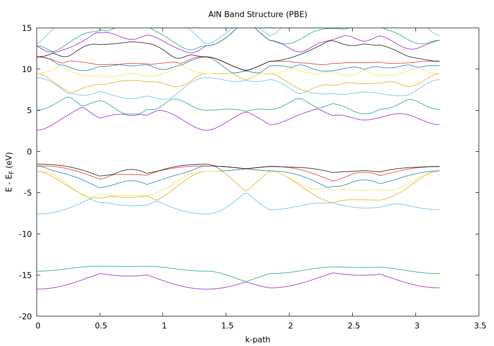

# AlN Quantum ESPRESSO Workflow

DFT calculations of wurtzite AlN with [Quantum ESPRESSO](https://www.quantum-espresso.org/):
variable-cell relaxation, self-consistent field, electronic band structure, and a Si-doped
supercell relaxation.

This repository contains the input files, post-processing scripts, and results of an
undergraduate computational-materials project. It is meant to document the workflow end to end
so that the results can be reproduced.

---

## Workflow

| Step | Input | Purpose |
|---|---|---|
| 1 | `inputs/01_vc-relax.in` | Variable-cell relaxation of the wurtzite cell (`a`, `c/a`) |
| 2 | `inputs/02_scf.in` | Self-consistent field on a 12×12×8 k-grid |
| 3 | `inputs/03_bands.in` | Band structure along Γ–M–K–Γ–A–L–H–A |
| 4 | `inputs/04_si_doped_relax.in` | Ionic relaxation of a 32-atom supercell with one Al → Si substitution |
| — | `scripts/convert_bands.py` | Flattens `bands.x` output into a multi-column table |
| — | `scripts/plot_bands.gnu` | gnuplot script for the band-structure figure |

## Computational details

- **Code**: Quantum ESPRESSO (`pw.x`, `bands.x`)
- **Functional**: PBEsol
- **Cell**: wurtzite AlN, `ibrav = 4`, a ≈ 3.11 Å, c/a ≈ 4.98/3.11
- **Cutoffs**: `ecutwfc = 40 Ry`, `ecutrho = 320 Ry`
- **SCF k-grid**: 12 × 12 × 8 (Monkhorst–Pack, automatic)
- **Band path**: Γ (0,0,0) – M (½,0,0) – K (⅓,⅓,0) – Γ – A (0,0,½) – L (½,0,½) – H (⅓,⅓,½) – A
- **Smearing**: Gaussian, `degauss = 0.01 Ry`
- **Convergence**: `conv_thr = 1.0d-9` (SCF), `1.0d-8` (relaxations)
- **Si doping**: 32-atom supercell, one Al substituted by Si (≈ 6.25 at.%)

## Repository layout

```
AlN-QE-DFT/
├── inputs/
│   ├── 01_vc-relax.in
│   ├── 02_scf.in
│   ├── 03_bands.in
│   └── 04_si_doped_relax.in
├── scripts/
│   ├── convert_bands.py     # bands.x .gnu -> multi-column .dat
│   └── plot_bands.gnu       # gnuplot rendering
├── results/
│   ├── aln_bands_all.png    # band structure along the full k-path
│   └── aln_bands_multicol.dat
└── data/
    ├── aln_bands_raw.gnu    # example bands.x output (input for the script)
    └── bands_x.in
```

## How to reproduce

1. **Get the pseudopotentials** (not included in this repository — see the note below):

   ```
   Al.pbesol-n-kjpaw_psl.1.0.0.UPF
   N.pbesol-theos.UPF
   Si.pbesol-n-rrkjus_psl.1.0.0.UPF
   ```

   Put them in `pseudo/` and adjust `pseudo_dir` in the input files if needed.

2. **Run the electronic-structure steps** (in order):

   ```bash
   pw.x < inputs/01_vc-relax.in > 01_vc-relax.out
   pw.x < inputs/02_scf.in      > 02_scf.out
   pw.x < inputs/03_bands.in    > 03_bands.out
   bands.x < data/bands_x.in    > bands_x.out
   ```

3. **Post-process and plot**:

   ```bash
   python scripts/convert_bands.py data/aln_bands_raw.gnu results/aln_bands_multicol.dat
   gnuplot scripts/plot_bands.gnu
   ```

4. **Optional — Si-doped supercell**:

   ```bash
   pw.x < inputs/04_si_doped_relax.in > 04_si_doped_relax.out
   ```

## Results



The band structure is plotted above (file: `results/aln_bands_all.png`).
As expected for a PBE-family functional, the calculated indirect gap is noticeably smaller
than the experimental value (~6.2 eV); the qualitative ordering of the bands and the location
of the conduction-band minimum are reproduced.

## Notes and limitations

- `scripts/plot_bands.gnu` uses a hard-coded Fermi energy reference (`8.5431` eV) taken from
  the SCF output. For a different system or run, update this value.
- `convert_bands.py` assumes `bands.x` output with one blank-line-separated block per band.
  It warns when blocks have inconsistent lengths.
- These are teaching/research inputs, not a converged production study: no systematic
  k-point or cutoff convergence tests are included.

## Pseudopotentials

The `.UPF` files are **not** distributed here, in line with their licensing terms. The
pseudopotentials used are from [PSLibrary 1.0.0](https://pseudopotentials.quantum-espresso.org/)
(PBEsol, `psl` naming). Download them from the QE pseudopotential library and keep the exact
filenames listed above so the inputs run unchanged.

## License

MIT — see `LICENSE`.

## Acknowledgements

Built on Quantum ESPRESSO and PSLibrary. Calculations were run on a Linux HPC cluster.
